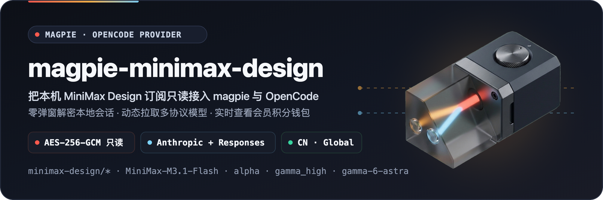
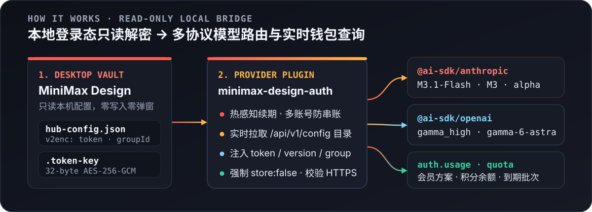

<p align="center">
  
</p>

<p align="center">
  <a href="#快速开始">快速开始</a> ·
  <a href="#与现有-minimax-插件的区别">插件定位区别</a> ·
  <a href="#工作原理">工作原理</a> ·
  <a href="#模型目录与协议">模型与协议</a> ·
  <a href="#环境变量与安全边界">配置与边界</a>
</p>

把本机已登录的 **MiniMax Design** 桌面端订阅接入 [magpie](https://usemagpie.ai/) 与 [OpenCode](https://opencode.ai/)（同时兼容 OpenCode 1.x / 2.x），让 Claude Code、Codex、OpenCode 等任意接入 magpie 的 agent 直接调用你的 MiniMax Design 多协议模型与会员积分，无需重复登录，也不修改桌面端任何本地文件。

> **English summary:** `opencode-minimax-design-auth` is a **provider plugin** that exposes your local **MiniMax Design** desktop subscription (`minimax-design` for China, `minimax-design-global` for Global) inside magpie and OpenCode. It reads `hub-config.json` + `.token-key` read-only, routes both `@ai-sdk/anthropic` (`/messages`) and `@ai-sdk/openai` (`/responses`) models dynamically, and surfaces live credit wallet balances via `magpie quota`.

## 实测效果

在隔离沙箱中通过本机 `magpie 0.1.4790` 实测（只读复用桌面端登录态，双协议连通 + 实时钱包读数）：

```text
$ magpie plugin login minimax-design "读取 MiniMax Design 桌面端登录态"
✓ signed in to MiniMax Design · its models are minimax-design/<model>

$ magpie provider test minimax-design MiniMax-M3.1-Flash
  ✓ anthropic  682 ms · MiniMax-M3.1-Flash

$ magpie provider test minimax-design alpha
  ✓ anthropic  19786 ms · alpha

$ magpie provider test minimax-design gamma_high
  ✓ responses  3519 ms · gamma_high

$ magpie provider test minimax-design gamma-6-astra
  ✓ responses  3158 ms · gamma-6-astra

$ magpie quota
minimax-design · Design Plus 年会员 · until Sep 29 · subscription
  可用积分 87,144 left ↻ Dec 24 08:00  会员积分 86,999 left  充值积分 145 left
```

## 与现有 MiniMax 插件的区别

对照社区仓库 [magpie-community/plugins](https://github.com/magpie-community/plugins)，三者职责与数据流向完全不同，可共存互不替代：

| 插件 | 类型 | 方向与用途 |
| --- | --- | --- |
| **本项目（`opencode-minimax-design-auth`）** | **Provider 插件** | **MiniMax Design → magpie**：把本机 MiniMax Design 订阅接入 magpie，供其他 agent 调用（`minimax-design` 中国区 / `minimax-design-global` 国际版） |
| `@magpie-community/opencode-minimax-auth`（`packages/minimax`） | Provider 插件 | **MiniMax Code (`mcode`) → magpie**：走设备码 OAuth 与 MiniMax Code 独立额度、签到体系 |
| `@magpie-community/agent-minimax-design`（`packages/minimax-design`） | **Agent 插件** | **magpie → MiniMax Design（方向相反）**：把 magpie 网关写进 MiniMax Design 当作自定义模型（仅 Windows） |

## 工作原理

<p align="center">
  
</p>

- **零弹窗只读解密**：按 MiniMax Design 的 `v2enc:` 格式使用同目录 32 字节 `.token-key`（AES-256-GCM）本地解出 `accessToken`、`selectedGroupIds[userID]` 与 `deviceId`，不弹窗索要钥匙串，也不回写任何桌面端配置。
- **热感知续期与多账号隔离**：基于文件 `mtime` 缓存，同一 `userID` 下桌面端重新登录或切换/取消团队空间（`X-Group-Id`）时自动生效；若桌面端切到其他账号，严格校验 `userID` 不跨账号串用积分。
- **单 Provider 多协议路由与原生媒体生成**：从 `GET /api/v1/config` 与 `GET /api/v1/models/config` 实时拉取账号下的对话模型、图像模型与视频模型（5 分钟缓存，断网时回退本地 `lkgProviderConfig` 与启动表），对话模型保留上游原始 ID 避免与真实账号误并组，图像与视频模型规范化显示名与 ID 并按站点区域隔离；同时拦截 OpenAI 兼容的 `/images/generations`、`/images/edits` 与 `/videos`（含 `/videos/{id}`、`/videos/{id}/content`）路由，直接对接 MiniMax Design 云端异步生图/生视频任务与 CDN 参考图上传。
- **安全与故障隔离**：所有鉴权请求均前置校验站点 HTTPS 白名单域名，阻断 HTTPS→HTTP 降级与跨区 307 重定向；配额不足归一为 `429` 且不误标登录态失效。

## 快速开始

### 1. 沙箱验证（推荐，不改动 `~/.config/magpie`）

```sh
# 零依赖单元测试（Bun 与 Node >= 20 均可）
bun test
node --test

# 在独立沙箱 HOME 中加载插件并实测（只读访问本机 MiniMax Design 状态）
SB="$PWD/.sandbox/try-minimax-design"
mkdir -p "$SB"
run_sb() {
  env -i PATH="$PATH" HOME="$SB" USERPROFILE="$SB" \
    XDG_CONFIG_HOME="$SB/.config" XDG_CACHE_HOME="$SB/.cache" \
    MINIMAX_DESIGN_DATA_DIR="$HOME/Library/Application Support/@hilo/desktop" \
    /Applications/magpie.app/Contents/MacOS/magpie "$@"
}

run_sb plugin add "$PWD"
run_sb plugin login minimax-design "读取 MiniMax Design 桌面端登录态"
run_sb models
run_sb quota
run_sb provider test minimax-design MiniMax-M3.1-Flash
run_sb provider test minimax-design alpha
run_sb provider test minimax-design gamma_high
```

### 2. 日常安装到 magpie

```sh
magpie plugin add github:GoooIce/magpie-minimax-design
magpie plugin login minimax-design           # 中国区；国际版用 minimax-design-global
magpie provider test minimax-design MiniMax-M3.1-Flash
magpie provider test minimax-design gamma-6-astra
```

### 支持的登录方式

| 方式 | 说明 | 适用平台 |
| --- | --- | --- |
| **读取桌面端登录态（推荐）** | 自动扫描本机 MiniMax Design 数据目录（macOS `~/Library/Application Support/@hilo/desktop`、Windows `%APPDATA%\@hilo\desktop`、Linux `~/.config/@hilo/desktop` 及 `MiniMax Hub Global`）；未登录时给出官网链接并轮询等待（最长 5 分钟，可取消） | macOS / Windows / Linux |
| **粘贴 `accessToken`** | 使用宿主原生的掩码密钥输入框粘贴会话 JWT（同时兼容 OpenCode 1.x / 2.x 与 magpie）；需要团队空间时配合 `MINIMAX_DESIGN_GROUP_ID` | 全平台 |

## 模型目录与协议

登录后由 `GET /api/v1/config`（对话模型）与 `GET /api/v1/models/config`（图像与视频模型）按账号实时刷新。对话模型保留上游原始 ID 与显示名（不与真实 Claude / Codex 账号混入同一自动分组）；图像与视频模型将国内站合规化名（如 `g-image-*`、`banana-*`、`悠船 8.2`、`SD 2.5`）映射为规范模型 ID 与显示名，底层请求仍保留上游实际 `model_name`。

### 对话模型（Anthropic Messages & OpenAI Responses）

| 模型 ID | 显示名 | 协议（SDK） | 特性 |
| --- | --- | --- | --- |
| `MiniMax-M3.1-Flash` | MiniMax-M3.1-Flash | `@ai-sdk/anthropic` (`/messages`) | 1M 上下文，工具调用，自适应思考 |
| `MiniMax-M3` | MiniMax-M3 | `@ai-sdk/anthropic` (`/messages`) | 工具调用，思考 |
| `MiniMax-M2.7` | MiniMax-M2.7 | `@ai-sdk/anthropic` (`/messages`) | 工具调用，思考 |
| `alpha` | Gamma-Op 5.5 | `@ai-sdk/anthropic` (`/messages`) | `low` / `medium` / `high` 思考档位（会员） |
| `gamma_high` | Gamma | `@ai-sdk/openai` (`/responses`) | 自动强制 `store: false`，`low` / `medium` / `high` |
| `gamma-6-astra` | Gamma-Astra | `@ai-sdk/openai` (`/responses`) | 自动强制 `store: false`，`low` / `medium` / `high`（会员） |

> 注：`/api/v1/config` 中的 `@ai-sdk/google`（`omega-3.1-pro`）直连 `/api/v1/models/*` 返回 404，本插件已主动过滤，避免目录出现不可用模型。

### 原生图像模型（magpie Settings → Images，`/v1/images/generations` & `/v1/images/edits`）

| 模型 ID | 显示名 | 后端 | 站点 |
| --- | --- | --- | --- |
| `MiniMax-H3-Image` / `MiniMax-H3-Image-Highspeed` | MiniMax H3 Image / Highspeed | `minimax_image` | 中国区 / 国际版 |
| `gpt-image-2.6-sunburst` / `gpt-image-2.6-flare` | GPT Image 2.6 Sunburst / Flare | `openai` | 中国区 / 国际版 |
| `gpt-image-2.5-sunburst` / `gpt-image-2.5-flare` / `gpt-image-2` | GPT Image 2.5 Sunburst / Flare / 2 | `openai` | 中国区 / 国际版 |
| `nano-banana-2` / `nano-banana-pro` | Nano Banana 2 / Pro | `nano_banana` | 中国区 / 国际版 |
| `doubao-seedream-5-0-pro-260628` / `doubao-seedream-4-5-251128` | Seedream 5.0 Pro / 4.5 | `seedream` | 中国区 / 国际版 |
| `midjourney-8.2`（国际版另含 `8.1` / `7` / `niji7`） | Midjourney 8.2 / 8.1 / 7 / Niji 7 | `midjourney` | 中国区 / 国际版 |

### 原生视频模型（magpie Settings → Video，`/v1/videos`）

| 模型 ID | 显示名 | 后端 | 站点 |
| --- | --- | --- | --- |
| `MiniMax-H3` / `MiniMax-H3-Max` | MiniMax H3 / Max | `minimax_v3` | 中国区 / 国际版 |
| `seedance-2.5` / `seedance-2.5-draft` / `seedance-2.0` | Seedance 2.5 / Draft / 2.0 | `seedance` | 中国区 |
| `wan-3.0-video` / `wan-3.0-video-prime` | Wan 3.0 / Prime | `wan_i2v` | 中国区 / 国际版 |
| `kling-v3-omni-video` / `kling-avatar` | Kling 3.0 Omni / Avatar | `kling` / `kling_avatar` | 中国区 / 国际版 |
| `veo-3.1` / `veo-3.1-fast` | Veo 3.1 / Fast | `veo3` | 国际版 |

## 额度查询（`magpie quota`）

通过 `GET /api/v1/credit/wallet`（随当前工作空间携带 `X-Group-Id`；失败或余额缺失时回退 `/api/v1/credit/balance`，团队空间优先展示 `team_credit`）读取：

- 会员方案名（`plan_name`）与到期时间（`end_time`）
- 主余额窗口（数字 `balance` + `unit`，不含 `used`/`aside`，支持 magpie 0 余额停用与多账号按余额路由）
- 分项积分明细（会员积分、充值积分、赠送积分等 `aside` 窗口）及最近到期批次（同刻到期自动汇总）

## 环境变量与安全边界

| 变量 | 用途 |
| --- | --- |
| `MINIMAX_DESIGN_DATA_DIR` | 严格覆盖 MiniMax Design 本地数据目录（设置后仅查该路径，不回落默认系统目录） |
| `MINIMAX_DESIGN_GROUP_ID` | 粘贴 `accessToken` 登录时可选指定的 `X-Group-Id` |
| `MINIMAX_DESIGN_VERSION_CODE` | 覆盖 `version_code` 请求头（默认读取本机应用版本，读不到时回退 `4.0.18`） |

- **已知验证范围**：已在 macOS 本机实测中国区 `minimax-design`（登录、动态目录、Anthropic 与 Responses 双协议调用、钱包额度）及 `bun test` / `node --test` 全量单测；Windows/Linux 桌面路径与国际版 `minimax-design-global` 仅经单元测试与源码对照验证。
- **风险提示**：本项目为非官方社区集成，协议与本地凭据读取基于对 MiniMax Design 桌面端的只读分析，上游随时可能变更。请仅在个人合规范围内使用，切勿提交任何真实 token、cookie 或账号信息。

## License

[MIT](./LICENSE) — 含上游 [magpie-community/plugins](https://github.com/magpie-community/plugins) 的 OpenCode 2.x 适配层（`opencode2.mjs`）。
